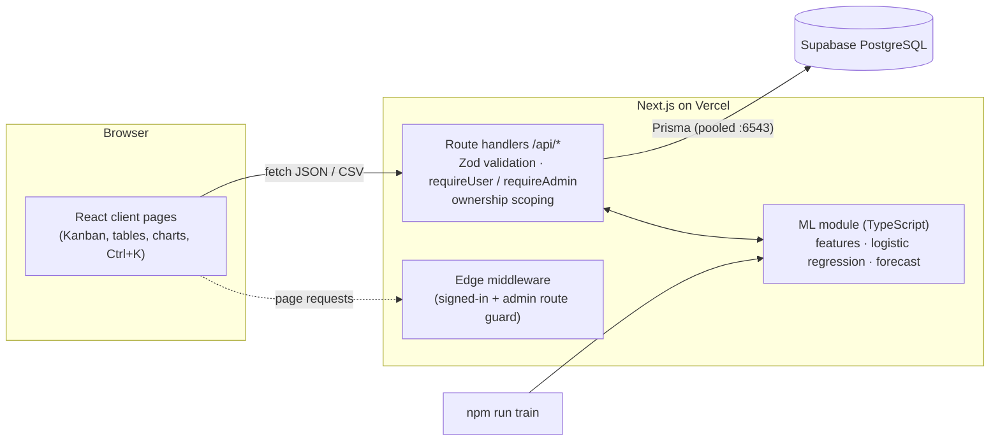
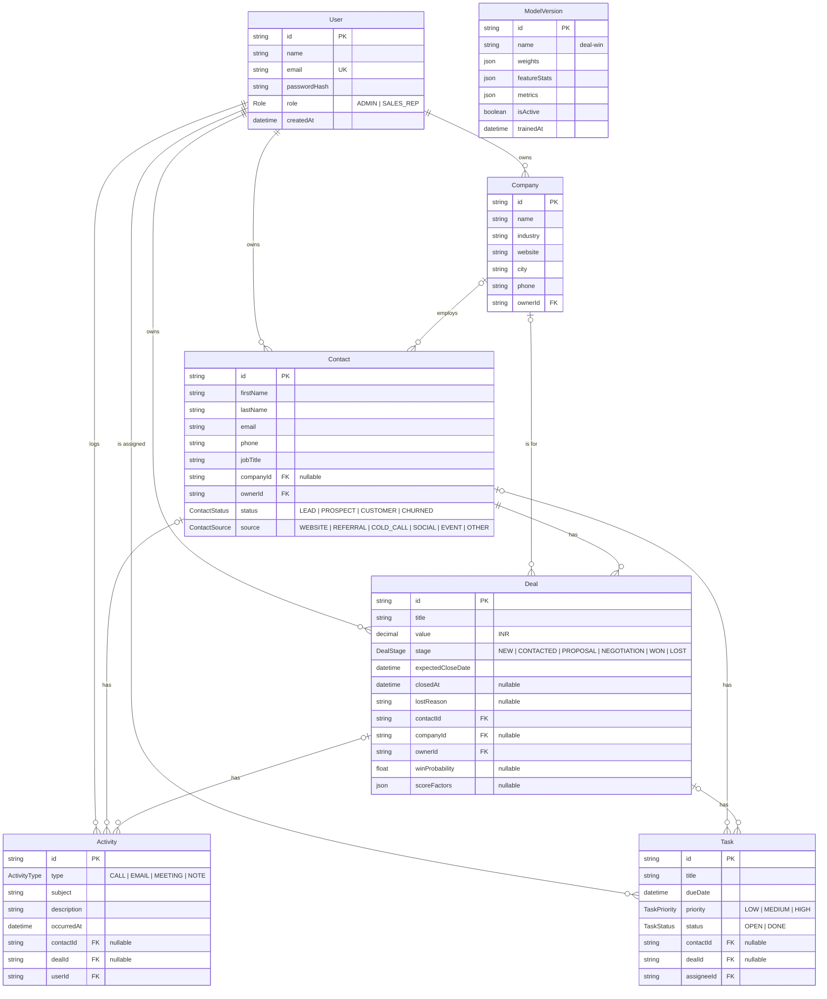

# Akshara CRM

A full-stack CRM for a small sales team: companies, contacts, a drag-and-drop deal pipeline, activities and follow-up tasks, plus built-in machine learning — a deal win-probability model written from scratch in TypeScript and a revenue forecast — all in Indian Rupees.

**Live demo:** `https://<your-app>.vercel.app` _(replace with your Vercel URL)_

| Role | Email | Password | Sees |
| :--- | :--- | :--- | :--- |
| Admin | `admin@akshara.test` | `Admin@123` | Every record, ML Insights, User Management |
| Sales rep | `rahul.sharma@akshara.test` | `Rep@123` | Only records they own |
| Sales rep | `priya.patel@akshara.test` | `Rep@123` | Only records they own |

---

## Features

- **Companies & Contacts** — searchable, filterable, sortable, paginated tables; create/edit dialogs; detail pages with related deals, activity timeline and tasks.
- **Deals pipeline** — Kanban by stage with ₹ column totals; drag to change stage (mouse, touch long-press or keyboard), optimistic updates with rollback; a lost reason is required for LOST; WON/LOST stamp `closedAt`. Table view with sorting by win score.
- **Activities & tasks** — log calls, emails, meetings and notes; reverse-chronological timelines; Open/Done task tabs with priority/assignee/overdue filters and one-click complete.
- **ML win probability** — Hot (≥70%) / Warm (40–69%) / Cold (<40%) badges with the top factors in plain English (“2 meetings held +12%”), rescored whenever a deal or its activities change.
- **Revenue forecast & dashboard** — KPIs, won revenue vs a projected trend, probability-weighted pipeline, pipeline by stage, leads by source, my tasks and recent activity.
- **Global search** — <kbd>Ctrl</kbd>/<kbd>⌘</kbd>+<kbd>K</kbd> (or <kbd>/</kbd>) across companies, contacts and deals.
- **CSV export** of contacts and deals, honouring the current filters and permissions.
- **User management** — admins create users and change roles; role changes apply on the very next request.
- Dark/light mode, responsive down to 375px, keyboard and screen-reader friendly (WCAG 2.1 AA checks with axe-core on every page in both themes).

## Tech stack

Next.js 14 (App Router, TypeScript strict) · Tailwind CSS · lucide-react · Recharts · @dnd-kit · Zod (shared client/server schemas) · Prisma ORM → Supabase PostgreSQL · NextAuth (Credentials, bcrypt, JWT) · Vitest · Vercel.

---

## Architecture



- **No database access from the browser.** Every read and write goes through `/api/*` route handlers that use Prisma on the server.
- **Authorization on the server, on every request.** `requireUser()` reads the caller's role from the database (not just the 30-day JWT), so a role change takes effect immediately. ADMIN sees everything; SALES_REP is scoped to `ownerId` (tasks: `assigneeId`) on lists, detail reads, writes, linked records, search and exports.
- **Consistent errors**: `{ error: { code, message, fields? } }` with proper HTTP status codes.
- **Business time is IST** (UTC+05:30): “today”, “overdue” and “this month” mean the same thing on the server (UTC on Vercel) as in the browser.

### Folder layout

```
src/
  app/(auth)/login                 sign-in page
  app/(dashboard)/…                dashboard, companies, contacts, deals, tasks, ml/insights, settings/users
  app/api/…                        route handlers (see API below)
  components/                      shell (sidebar/header), ui primitives, DataTable, charts, feedback (toasts, confirm)
  features/<module>/               components · schemas (Zod) · server (queries) — activities, auth, companies,
                                   contacts, dashboard, deals, ml, search, tasks, users
  lib/                             prisma, auth, formatters (₹ / DD MMM YYYY), pagination, csv, dates (IST)
  lib/ml/                          logisticRegression · features · split · metrics · explain · forecast · trainCli
prisma/                            schema.prisma · migrations · seed.ts
```

### API

| Endpoint | Methods | Notes |
| :--- | :--- | :--- |
| `/api/companies`, `/api/companies/[id]` | GET POST · GET PATCH DELETE | search, industry/owner filters, sort, pagination |
| `/api/contacts`, `/api/contacts/[id]` | GET POST · GET PATCH DELETE | search, status/source/owner/company filters |
| `/api/contacts/export` | GET | CSV, same filters (max 5,000 rows) |
| `/api/deals`, `/api/deals/[id]` | GET POST · GET PATCH DELETE | `?view=board` returns stage columns with DB-aggregated counts and ₹ totals |
| `/api/deals/export` | GET | CSV, same filters |
| `/api/activities`, `/api/activities/[id]` | GET POST · GET PATCH DELETE | rescoring the linked deal on every change |
| `/api/tasks`, `/api/tasks/[id]` | GET POST · GET PATCH DELETE | status/priority/assignee/overdue filters, per-tab counts |
| `/api/users`, `/api/users/[id]` | GET POST · PATCH | create + change role (admin); can't change own role or remove the last admin |
| `/api/dashboard/stats` | GET | KPIs, charts, forecast — all DB aggregates, role-scoped |
| `/api/search?q=` | GET | top 5 companies, contacts and deals the caller may see |
| `/api/ml/train` · `/api/ml/model` | POST · GET | admin only |
| `/api/health` | GET | runs a real DB query |

---

## Data model



Delete rules: deleting a contact cascades to its deals, activities and tasks; deleting a deal cascades to its activities and tasks; deleting a company keeps its contacts and deals but unlinks them (`SET NULL`); users can't be deleted while they own records (`RESTRICT`). Indexed: `ownerId`, `stage`, `status`, `dueDate`, `closedAt`.

---

## Machine learning

### Deal win probability — logistic regression from scratch

`src/lib/ml/logisticRegression.ts` — pure, typed functions: z-score normalisation (fitted on the training split only), batch gradient descent, L2 regularisation on the weights (λ = 0.01, learning rate 0.1, up to 3,000 iterations, early stop on a flat loss).

**Features** (`src/lib/ml/features.ts`), each measured *as of a reference date* — the close date for training rows, now for open deals — so activity logged after a deal closed never leaks into training:

| Feature | Encoding |
| :--- | :--- |
| Deal value | log(1 + ₹) |
| Activities in the last 14 days | count |
| Total activities | count |
| Days since last activity | days (no activity ⇒ days since the deal opened) |
| Deal age | days |
| Meetings held | count |
| Contact source | one-hot (6) |
| Company industry | one-hot, top 5 industries + OTHER |

**Training** (`npm run train` or **ML Insights → Retrain model** / `POST /api/ml/train`): closed deals only (WON = 1, LOST = 0), deterministic row order, stratified 80/20 split with seed 42. The new `ModelVersion` stores weights, normalisation stats and metrics, and becomes the only active version; then every open deal is rescored.

**Metrics** on the seed data (reproducible — reseeding gives identical numbers):

| Hold-out accuracy | Precision | Recall | Hold-out AUC | 5-fold CV accuracy / AUC | Baseline (“always won”) |
| :---: | :---: | :---: | :---: | :---: | :---: |
| 80.0% | 81.8% | 81.8% | 0.889 | 77.5% / 0.844 | 55.5% |

Because a 40-row hold-out moves 2.5 points per deal, a stratified 5-fold cross-validated accuracy and AUC are stored alongside it as the steadier estimate.

**Inference & explanations**: when a deal or one of its activities is created, edited or deleted, the deal is rescored and `winProbability` plus per-factor contributions (`weight × standardised value`, grouped per feature) are stored on the deal. Each factor's impact is shown in percentage points: the probability minus the probability with that feature at the training average. The badge tooltip lists the top 3 helping and hurting factors.

**Fallback**: with no active model, or fewer than 30 closed deals, deals show “Not enough data” instead of a score.

### Revenue forecast

- **Expected revenue** for this month and next = Σ(open deal value × win probability) for deals expected to close in that month.
- **Trend** = least-squares line through the last 12 complete months of won revenue, projected 3 months ahead (floored at ₹0).
- The dashboard chart shows actual won revenue, the fitted trend (solid), the projection (dashed) and the weighted pipeline. Every chart has a “View as table” fallback.

### Limitations

- **Stage is not a model feature.** The schema keeps no stage history and closed deals only carry WON/LOST — the label itself — so a stage ordinal would leak the outcome. Stage is shown on open deals but excluded from training. Adding a `stageAtClose` column would allow it.
- **Small, synthetic training set.** 200 seeded deals. The model recovers the main drivers the seed generator used — meetings held, referral (+) vs cold-call (−) source, recent activity — and gives near-zero weight to things the generator ignored (industry, deal age). Drivers with a very small effect in the generator (deal value) aren't reliably recovered from 200 rows, and some weights are artefacts of how the data was generated — e.g. a long gap since the last activity looks positive because seeded activities are spread evenly over each deal's life. Retrain on real history before trusting the scores.
- Logistic regression is linear in the (standardised) features; interactions such as “meetings matter more for large deals” aren't modelled.
- Scores rank deals; they are not calibrated guarantees.

---

## Getting started

```bash
cp .env.example .env          # Supabase URLs + AUTH_SECRET (openssl rand -base64 32)
npm install
npm run db:migrate            # apply migrations (uses DIRECT_URL)
npm run db:seed               # 3 users, 10 companies, 60 contacts, 240 deals, ~420 activities, 30 tasks
npm run train                 # train and activate the win-probability model
npm run dev                   # http://localhost:3000
```

| Script | What it does |
| :--- | :--- |
| `npm run dev` / `build` / `start` | Next.js development server / production build / serve the build |
| `npm run lint` | ESLint (Next.js rules) |
| `npm test` | Vitest — logistic regression convergence and regularisation, metrics/AUC, stratified split & k-fold, feature engineering and labels, IST month maths, forecast, CSV writer |
| `npm run train` | Train on closed deals, activate the model, rescore open deals |
| `npm run db:seed` | Reset and reseed the database (deterministic) |

Environment variables (see `.env.example`): `DATABASE_URL` (Supabase pooled, port 6543, `?pgbouncer=true&connection_limit=1`), `DIRECT_URL` (direct, port 5432, migrations), `AUTH_SECRET`/`NEXTAUTH_SECRET`, `NEXTAUTH_URL`.

## Deploying on Vercel

Import the GitHub repo, set the environment variables above, and use the build command:

```bash
prisma generate && prisma migrate deploy && next build
```

(`npm run vercel-build`). After the first deploy, sign in as the admin and press **Retrain model** on ML Insights so open deals get scores.

## Quality checks

Each release is verified against a real PostgreSQL database with the seed data:

- `npm run build`, `npm run lint` (zero warnings) and `npm test` pass.
- API suites cover CRUD, validation errors, stage rules, rep-vs-rep isolation (every cross-owner read/write/link attempt returns 403), search and export scoping, user management and immediate role changes, ML training/inference, and dashboard numbers recomputed independently in SQL.
- Browser suites (Playwright) cover drag-and-drop (mouse and keyboard), optimistic rollback, the lost-reason prompt, dialogs and focus handling, CSV downloads, Ctrl+K search, mobile layouts at 375px on every page, and axe-core WCAG 2.1 AA scans of every page in light and dark mode.
